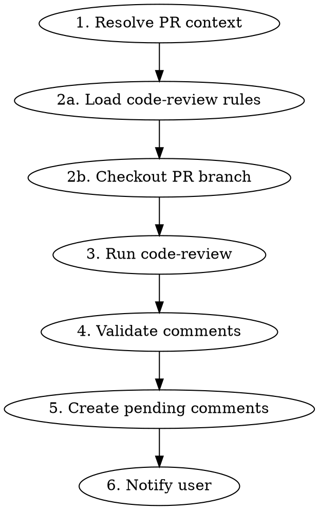

# PR Review Workflow

## Overview

Review a GitHub PR, produce findings via `code-review`, and post them as pending review comments. Ends after notification — no fix cycle.

**Announce at start:** "I'm using the review-workflow (PR review) skill to review this PR."

<HARD-GATE>
These rules are non-negotiable for ALL PR reviews.

1. Findings MUST be posted as pending review comments. No exceptions.
   - Each finding = one separate comment with line-level annotation.
   - Do NOT bundle multiple findings in one comment.
   - Do NOT output findings only to terminal when source is a GitHub PR.

2. NEVER submit the pending review. The user submits manually.
   - Do NOT call submit_pending.
   - Do NOT ask "要不要 submit?"
   - Do NOT offer to submit.

3. After creating the pending review, notify the user with the comment count, the PR
   link and the PR's purpose. A zero-finding review is still created and still notified —
   see Early Exit.
   That is the terminal state. Stop.
</HARD-GATE>

## Process



## Step 1: Resolve PR Context

Use `github-pr` skill (or GitHub MCP tools directly) to gather:
- PR metadata (title, author, base, head, files changed)
- PR diff
- Existing review comments (to avoid duplicates)

Step 1's output is exactly these three items. Every other read — the changed files in full,
their callers, a dependency PR's source — belongs to Step 3, after the rules are loaded.

## Step 2: Load Rules, Then Checkout

### 2a. Load code-review rules

Invoke the `code-review` skill now, before checkout, passing the PR title as branch objective
for scope classification, and run the parts that need only Step 1's file list:

1. Its Steps 1–3: classify the changed files, build the candidate skill list, run the
   contract-change gate
2. Its Step 5 activation prelude: read the SKILL.md of every mandatory and user-specified
   candidate

2a's output is the list of skills whose SKILL.md was actually read. Checkout and every file
read come after that list exists.

Why this order: a reader who opens the changed files first forms a verdict before any rule is
loaded, and the rules then only get checked against that verdict. A mandatory skill that was
never read stays unread without anything noticing.

### 2b. Checkout PR branch

**Goal:** Full local file access for enclosing-scope analysis, always at PR's latest commit.

**Determine remote:** PR refs (`pull/N/head`) live on the repo where the PR was opened (base repo). Identify the local remote pointing to `{base.repo.full_name}` from Step 1 metadata — `origin`, since branches and PRs both live in the org repo.

**Where to check out:** the directory this session started in is not automatically the place. Other
sessions may be working in it, and `pr-{N}` may already be checked out in another worktree. Pick the
review directory `W` from what the repository shows now, with this probe for "is a checkout free":

```bash
# Empty output = free. Otherwise the JSON says who or what holds it: another Claude session started
# there, a dev server running from there, a rebase/merge in progress, or uncommitted tracked changes.
probe() { jq -nc --arg d "$1" '{tool_input:{command:"git reset --hard"},cwd:$d}' \
  | ~/.claude/hooks/guard-shared-checkout.py; }
```

If `~/.claude/hooks/guard-shared-checkout.py` does not exist, treat every existing checkout as not free.

1. `git worktree list` — find whether `pr-{N}` is checked out, and in which worktree.
2. Choose `W` by the first row that matches:

   | What `git worktree list` and `probe` show | `W` |
   |---|---|
   | `pr-{N}` checked out in worktree X, `probe X` empty | X |
   | `pr-{N}` checked out in worktree X, `probe X` not empty | none — stop, tell the user what the probe reported, and wait |
   | `pr-{N}` checked out nowhere; some worktree Y has `probe Y` empty | Y — prefer one whose current branch is an earlier `pr-*` |
   | `pr-{N}` checked out nowhere; every probe is non-empty | a new worktree: `git worktree add <scratchpad>/pr-{N} --detach` |

3. Bring `W` to the PR head:
   ```bash
   git -C W fetch {remote} pull/{N}/head
   git -C W checkout -B pr-{N} FETCH_HEAD
   ```
4. Tell the user in one line which directory the review reads from. From here on every command
   and file read uses `W`'s absolute path or `git -C W` — a `cd` into `W` does not persist between
   tool calls — and Step 3 passes `W` to `code-review` as the root it reads the changed files from.
5. If fetch fails (permissions, network), fall back to API-only mode (diff from Step 1).

## Step 3: Run code-review

Continue the `code-review` run started in 2a. Delegate analysis entirely to it:
- `code-review` runs its Step 5 per-file loop and Step 6 (review, produce findings), with the
  rules from 2a already loaded
- `code-review` does NOT handle output — it returns structured findings

**Do NOT** re-implement review logic. `code-review` is the analysis engine.

## Step 4: Validate Comments

Load [post-review-validation.md](post-review-validation.md) and run V1–V4 checks on every finding before posting:

- V1: Line number correctness (re-derive from diff hunk header)
- V2: Rule applicability (skill matches file type)
- V3: Severity correctness
- V4: Language & format (zh-TW, no bundled issues)

Auto-fix or discard as defined in post-review-validation.

## Step 5: Create Pending Review Comments

1. Create a pending review: `pull_request_review_write` (method: `create`, NO `event` parameter)
2. For each validated finding, add a comment: `add_comment_to_pending_review`
   - One finding per comment
   - Line-level annotation via tool params: the finding's own anchor `{file}:{line}` → `path` / `line` / `startLine` / `side`. NOT repeated in body.
   - **Body = code-review's finding block, verbatim.** Take that finding's block from code-review's Step 6 output and use it as the comment body, prefixed with a severity tag. Do NOT reformat, reorder, drop, or rename fields.

     Body layout (per finding):

     ```
     [{severity}] [{category}] {issue description}
     **規則來源**：{skill name}
     **修復參照**：{skill name} → {section}
     **參考依據**：{file}:{line} — {實際讀到的內容}
     **導致問題**：{what this causes}
     **期望目標**：{what the correct state should be}
     **建議修復**：{tiered strategy}
     ```

   - Empty fields keep their label using code-review's degraded form (e.g. `**修復參照**：N/A`).
   - Report-envelope lines never go in a body: `檢查檔案數 / 候選規則 / 實際套用 / Interface impact / 摘要 / 結論`, nor the `CRITICAL/HIGH/MEDIUM/LOW` group headers — severity is carried by the per-comment `[{severity}]` tag.

**Reminder:** Do NOT pass `event` to the create call. Do NOT call `submit_pending`.

## Step 6: Notify User

Every notification ends with the `這個 PR 的目的` line. `{pr_purpose}` is one short sentence
in 繁體中文, in the form 「讓{誰}{得到什麼}」: who benefits and what they get once the PR
ships, worked out from the PR description and the diff. Example:
`讓設計師在 Storybook 上不用自己指定比較基準，就能直接看到這條 branch 改了哪些畫面。`
It lives in this notification only; the pending review body and comments keep the layouts
defined in Step 5 and Early Exit.

Output notification:

```
Pending review 已建立，共 {N} 筆 comments。

驗證結果：
  ✅ 通過：{N} 筆
  🔧 自動修正：{N} 筆
  🗑️ 丟棄：{N} 筆（規則不適用）
  ⚠️ 需人工檢查：{N} 筆

請到 GitHub 預覽並 submit：
https://github.com/{owner}/{repo}/pull/{pr_number}

這個 PR 的目的：{pr_purpose}
```

When all comments pass with zero fixes/discards/flags, simplify:

```
Pending review 已建立，共 {N} 筆 comments。
請到 GitHub 預覽並 submit：
https://github.com/{owner}/{repo}/pull/{pr_number}

這個 PR 的目的：{pr_purpose}
```

**This is the terminal state. STOP here.**

## Early Exit: No Findings

If `code-review` produces zero findings or verdict is `PASS — 未發現問題`, the review still
lands on the PR — as a body with no pins, for the user to approve.

1. Create a pending review carrying only a body: `pull_request_review_write`
   (method: `create`, NO `event`, `body` set). Body:

   ```
   Review 完成，未發現問題。

   檢查檔案數：{N}
   實際套用：{activated skills}
   ```

2. Add NO comments. A zero-finding review is a body, not a pin.
3. Notify the user, then stop:

   ```
   Review 完成，未發現問題。已建立 pending review（無 comment），請到 GitHub approve：
   https://github.com/{owner}/{repo}/pull/{pr_number}

   這個 PR 的目的：{pr_purpose}
   ```

   `{pr_purpose}` is defined in Step 6.

**Why not just report to the terminal:** the review is still waiting on a decision only the
user can make, and a pending review is what makes that visible on the PR — and what the Stop
hook watches for to notify. A terminal-only report leaves no trace anywhere.

**Reminder:** the HARD-GATE holds unchanged here — do NOT pass `event`, do NOT call
`submit_pending`. The approve is the user's.

## Common Mistakes

| Mistake | Fix |
|---------|-----|
| Submitting the pending review | NEVER submit. User does this manually. |
| Outputting findings to terminal instead of PR comments | HARD-GATE: findings MUST be posted as pending comments |
| Skipping fetch when already on PR branch | Always fetch the latest PR ref into `W`, even if `W` is already on `pr-{N}` |
| Checking out in the directory the session started in because that is where commands run | Choose `W` from `git worktree list` and `probe`; the starting directory is one candidate, not the default |
| Going ahead in a checkout whose probe reported someone | Stop and tell the user; another session's files would move under it |
| Skipping checkout, reviewing with API diff only | Always attempt local checkout first for full file access |
| Re-implementing review logic | Delegate entirely to code-review |
| Reading the changed files or a dependency PR before code-review's rules are loaded | Run 2a first; the file reads belong to Step 3 |
| Listing a skill as applied in the review body when its SKILL.md was never read | List only the skills from 2a's output plus those activated in Step 3 |
| Bundling multiple findings in one comment | One finding = one comment |
| Asking user whether to submit | Do NOT ask. Just notify and stop. |
| Skipping post-review-validation | Always validate before posting |
| Reporting "no findings" to the terminal only | A zero-finding review still creates a pending review carrying the body alone — the user approves it |
